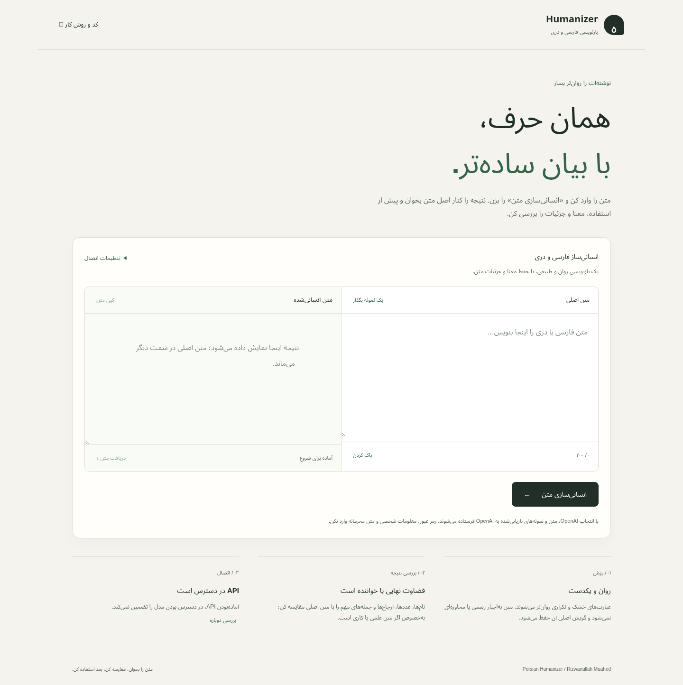

# Persian Humanizer

[](https://github.com/rizwanullahmuahed2-ui/Persian_Humanizer_Ai/actions/workflows/checks.yml)

Paste a Persian or Dari passage, rewrite it, and compare the result beside the original. There is one rewriting mode. You can stop a request, copy the completed result, or download it as text.

I built this around a simple question: can examples of better wording help a small language model rewrite a passage without changing what it says? The app retrieves paired examples, adds a few to the prompt, and streams the response. It does not fine-tune the model.



## مقاله و گزارش تحقیقی جاری

**نویسندهٔ مقاله: رضوان‌الله موحد.** استاد عبدالاول قریشی، دریافت‌کنندهٔ گزارش و استاد نویسنده‌اند؛ ایشان نویسندهٔ مقاله معرفی نشده‌اند.

- [مقالهٔ اصلاح‌شده PDF](research/current/Article.pdf) · [Word](research/current/Article.docx)
- [گزارش کامل برای استاد](research/current/Report_to_Supervisor_Dari.pdf)
- [بستهٔ کامل کد، دیتا و شواهد](research/current/Research_Package.zip)
- [راهنمای فایل‌ها و بررسی مستقل](research/current/README.md) · [کد و پاسخ‌های خام](research/revision/experiments/)

نسخهٔ جاری ۲۵ منبع و هفت شکل دارد. آزمایش اصلی ۸۰۰ پاسخ و ماژول عددیِ جدا ۸۰ پاسخ واقعی دارند. برای بررسی شواهد، از ریشهٔ ریپو `python research/verify_research.py` را اجرا کنید؛ NumPy لازم است و درخواست API تازه‌ای فرستاده نمی‌شود.

## Run locally

You need Python 3.13+, [uv](https://docs.astral.sh/uv/), and [Ollama](https://ollama.com/).

```sh
git clone https://github.com/rizwanullahmuahed2-ui/Persian_Humanizer_Ai.git
cd Persian_Humanizer_Ai
uv sync --locked
ollama pull llama3.1:8b
uv run --locked python backend/api.py
```

Keep Ollama running, then open **http://127.0.0.1:8000/ui/**. The first rewrite may download the retrieval models. The input limit is 2,000 characters. For startup problems or the optional OpenAI connection, see the [setup guide](docs/DEVELOPMENT.md#run-locally). A healthy API does not mean the selected model is ready.

## Inside the app

[Example HTTP requests](examples/requests.http) show a health check and a local-model rewrite.

- **Frontend:** HTML, CSS and JavaScript; right-to-left layout with mobile styles.
- **Backend:** FastAPI and LangGraph, with the same prompt for JSON and streamed responses.
- **Retrieval:** Chroma, multilingual MiniLM embeddings and a cross-encoder reranker. Only the original side of each text pair is embedded.
- **Generation:** local Llama 3.1 8B through Ollama, or GPT-4.1 mini through a server-side OpenAI key.

The interface uses Afghan Dari wording. The prompt preserves the input's meaning and register and asks it not to introduce Iranian regional vocabulary into Dari text. The historical corpus contains several Persian registers; its labels and original wording are retained for research.

## Checks

```sh
python -m pip install -r requirements-test.txt
python -m pytest -q
node --test tests/stream.test.mjs
ruff check backend eval tests
```

These checks use controlled model responses. They cover the API, CSV loading, prompt consistency, cleanup, interrupted streams and UTF-8 handling. They do not test live inference or measure how natural a rewrite sounds.

## Research and limits

The [current research documents](research/README.md) include the single-author manuscript, instructor report, raw evidence and citation. The original supplied PDF is retained as explicitly superseded historical evidence. The [development guide](docs/DEVELOPMENT.md) covers the dataset, evaluation scripts, endpoints and repository layout.

Read each rewrite before using it: a model can change a fact or number. Automatic lexical scores are diagnostics, not a reliable quality rating. OpenAI requests send the input and selected examples to that provider and incur usage charges. Keep private material out of requests you do not want to share.

This is a local development app. Public hosting needs authentication, request limits and deployment work.
