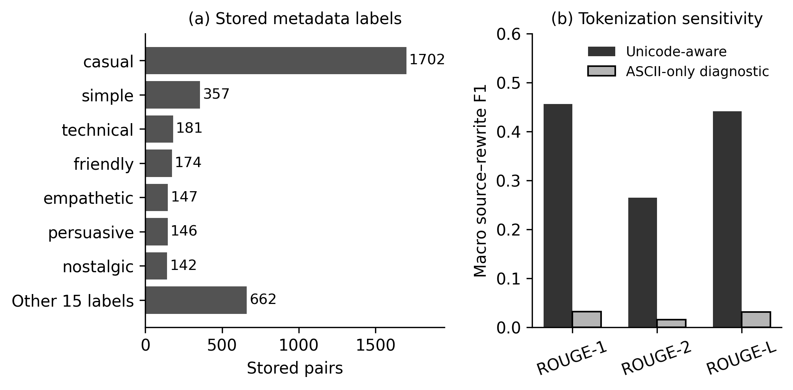
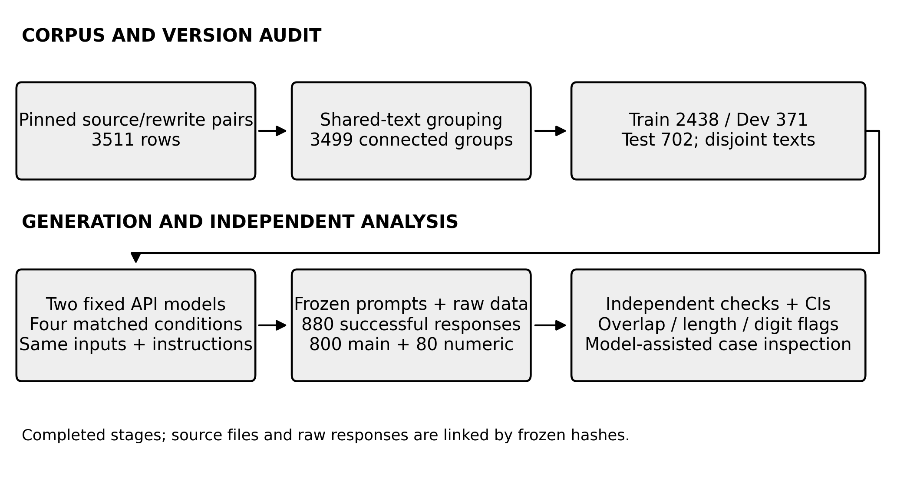
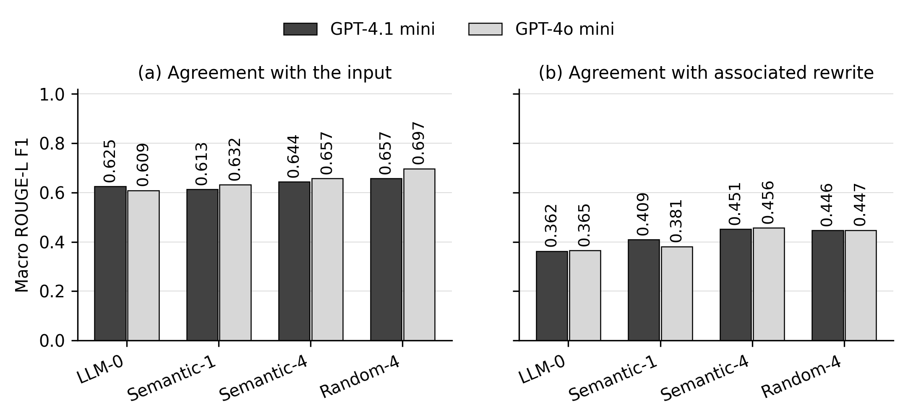
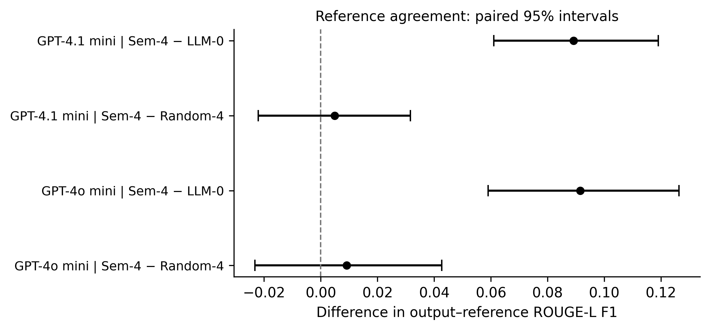

# Retrieval-Guided Persian Rewriting: An Artifact Audit and a Two-Model Controlled Study

**Rizwanullah Muahed**  
Department of Computer Science, Kabul Polytechnic University, Kabul, Afghanistan  
Corresponding author: rizwanullahmuahed2@gmail.com

## Abstract

Retrieving examples offers a way to guide Persian rewriting without adapting model parameters, but any benefit must be distinguished from the effect of supplying examples at all. We audit a rewriting prototype and compare four prompting conditions in a paired study of two fixed model snapshots. The repository contains 3511 source–rewrite pairs, inconsistencies between the training and index files, and a prompt formatter that supplies a different number of examples from the requested retrieval depth. Unicode-aware processing further reveals how strongly Persian tokenization affects corpus-overlap scores. We construct text-disjoint training/development/test partitions of 2438/371/702 records and select 100 test inputs from distinct groups. GPT-4.1 mini and GPT-4o mini each rewrite these inputs with zero examples, one or four semantic examples, and four random examples, producing 800 verified responses. A separate numerical-coverage module provides 80 responses for ten test sources. Compared with zero examples, four semantic examples increase output–associated-reference ROUGE-L F1 by 0.0892 and 0.0915. The corresponding advantages over random examples are 0.0049 and 0.0092, with paired 95% bootstrap intervals that span zero. Because the references include register shifts and have not been verified for preservation, these scores measure lexical agreement rather than naturalness or factual accuracy. Model-assisted inspection finds changes to events, shifts in register, and omitted qualifiers. The results show convergence toward the references under example prompting, while the advantage of semantic selection over random selection remains unestablished for this outcome. Versioned artifacts, raw responses, and independent verification make the study reproducible.

**Keywords:** Persian rewriting; Dari; retrieval-augmented generation; example retrieval; reproducibility; evaluation; Unicode tokenization.

## 1. Introduction

A rewrite may be grammatically fluent yet change a deadline, weaken an obligation, add an unsupported statistic, or turn a formal message into casual speech. A useful Persian rewriting system must improve expression while preserving these aspects of the input. We call this objective *naturalization*: making wording more natural while retaining propositional content, communicative force, register, and language variety. The term makes no claim about human authorship.

Retrieved examples could help a generator perform this task. An embedding model finds source texts similar to the input, and the generator receives those texts and their associated rewrites as demonstrations. In knowledge-grounded question answering, retrieved material supplies facts; here, it primarily illustrates a transformation. That difference matters for evaluation and design. A retrieved pair may model an unsuitable register or an unsupported factual addition even when its source closely resembles the query.

The prototype combines multilingual sentence embeddings, ChromaDB, LangGraph, FastAPI, and a Llama 3.1 8B model served through Ollama. The earlier manuscript described the application and selected examples without isolating retrieval's contribution. It also treated low lexical overlap as evidence of successful humanization. Low overlap, however, can arise from acceptable paraphrasing, unsupported changes, unrelated output, or tokenization that discards the script. An already clear sentence may need only a small edit.

We begin by examining the evidence available in the artifacts. The audit checks the corpus, index, prompt path, and metric definitions before treating any historical figure as a confirmed experimental result. A controlled API study then tests retrieval's contribution, holding the inputs and preservation instruction constant across conditions within each model. Three research questions guide the work:

- **RQ1—Artifact consistency:** Do the available corpus, training file, stored index, and prompt construction describe a consistent and reproducible experiment?
- **RQ2—Measurement validity:** How sensitive are the reported lexical descriptions to Persian text processing, and what conclusions can those descriptions support?
- **RQ3—Observable generation effects:** Under a fixed generator and preservation instruction, how do semantic example selection and retrieval depth affect copying, source-wording retention, associated-reference agreement, and output length relative to zero examples and random examples?

The artifact and corpus audits address RQ1 and RQ2; the paired generation study addresses RQ3. Although the application aims to produce natural, meaning-preserving text, the study measures a narrower set of generation outcomes. Its contributions are an empirical audit of the artifacts, an analysis of Persian text processing, and a controlled comparison of semantic selection with an instruction-only baseline and a random-example control. The integration of tools contributes to the engineering of the application; it supplies no evidence of improved language quality.

## 2. Related work and scope

The encoding and generation components build on transformer architectures [1]. Few-shot language modeling provides a basis for using demonstrations to guide a task at inference time without updating parameters [2]. For rewriting, the relevant question is whether selected demonstrations guide the model more effectively than examples chosen without semantic matching.

Lewis et al. introduced retrieval-augmented generation for knowledge-intensive tasks through a training and fine-tuning recipe [3]. Retrieving rewrite examples for a frozen generator follows a different implementation strategy and does not show that the original RAG method dispensed with fine-tuning. Li et al.'s Delete–Retrieve–Generate framework likewise uses retrieval for text transformation, extending its role beyond factual question answering [4].

Prompt-based rewriting without parameter adaptation predates this application. Reif et al., for example, demonstrate arbitrary style transfer with large language models [5]. Avoiding fine-tuning is therefore insufficient as a novelty claim. The contribution must instead rest on whether retrieving demonstrations measurably benefits a clearly defined Persian rewriting task.

Research on in-context learning has examined example selection directly. Liu et al. compare semantically retrieved examples with random examples for GPT-3 [6], while Rubin et al. train a prompt retriever using language-model feedback [7]. Min et al. find that demonstration format and input distribution explain important effects in classification and multiple-choice tasks [8]. These studies motivate the controls used here. They leave open whether semantic selection helps Persian rewriting and whether inaccurate rewrite targets undermine preservation.

Representation learning and retrieval also serve different purposes across these systems. Sentence-BERT encodes sentences separately to support efficient similarity comparisons [9]; multilingual knowledge distillation extends that approach across languages [10]. Dense passage retrieval instead learns query–passage representations for question answering [11]. In the present task, the retrieved pairs demonstrate how to transform text, without supplying additional facts for the rewrite.

Persian formality transfer and normalization offer relevant resources, although their objectives differ from preserving register during naturalization. Falakaflaki and Shamsfard examine informal-to-formal transformation and the weaknesses of evaluation based only on overlap [12]. Those weaknesses do not justify treating ROUGE as a score to minimize. Tajalli et al. provide an informal–formal corpus, described in a later publication in 2025 [13], and Rasooli et al. study the standardization of colloquial Persian [14]. Resources intended to change register require validation before they can serve as references for preserving it.

Evaluation research distinguishes naturalness, content preservation, and the intended behavior of style [15,16]. Here, the intended behavior is to preserve style unless the user explicitly requests a separate conversion task. ROUGE [17], chrF [18], and contextual similarity measures such as BERTScore [19] offer complementary diagnostics, but no single measure certifies factual equivalence or an acceptable register. Human evaluation also requires documented instructions, sampling, and actual ratings; output length cannot stand in for those ratings [16].

The Llama 3 family supports local deployment [20]. Persian and Dari, however, are absent from the eight officially supported languages listed in the Llama 3.1 model card [21], so performance in this application requires measurement. Accepting Dari input through an interface also says little about whether the demonstration corpus represents Dari or has been independently validated for that variety.

## 3. Task definition and evidence design

### 3.1 Preservation before stylistic change

Let $x$ denote the input, $D$ the retrieval corpus, $R_k(x;D)$ the ordered demonstration set, and $G_\theta$ the generator. The generated rewrite is

$$ y_k = G_\theta(P(x,R_k(x;D));\lambda). $$

The complete prompt is $P$, and $\lambda$ specifies the decoding and runtime settings. The aim is more natural wording while preserving named entities, quantities and units, dates and times, negation, conditions, obligations, certainty, register, and dialect. Each is a separate dimension of evaluation; a single weighted heuristic would obscure these distinctions.

The datasheet approach emphasizes documenting how examples were collected, who produced them, and which uses they support [22]. We retain the corpus fields `ai` and `human` as schema names, using them to mean *source* and *associated rewrite*. The available files do not identify each record's generator, establish human authorship, name annotators, or verify dialect. Accordingly, the field name `human` establishes neither authorship nor semantic correctness.

Figure 1 traces the retrieval and prompting path used in the experiment. The searchable pool contains training sources only. Once a source is selected, its associated rewrite joins it as a demonstration. The query's own associated rewrite is withheld from the prompt.

### 3.2 Audited snapshot

We audit repository `rizwanullahmuahed2-ui/Persian_Humanizer_Ai` at commit `feb0f282430b13277c43dd32ca93ceec13c837df`. The supplied 21-page PDF is byte-identical to the snapshot's PDF, and the full corpus has SHA-256 `44e9912ce119bf5014165087af10b5ad7ce675ef8e3c17e90cd9031cecf8d39f`. Separate scripts inspect the CSV files, read SQLite metadata without executing serialized index objects, and examine reachable Git history.

The search covers the available checkout and its seven reachable commits, all of which contain the same 3511-row full corpus. Within that scope, we find neither the exact 3173-pair version nor a generation-output archive. Such material may have existed elsewhere. We therefore retain the historical measurements as unverified reports rather than assigning them to the current corpus.

### 3.3 Text normalization and overlap

To make comparisons reproducible, we apply Unicode NFKC normalization; map Arabic kaf and yeh variants to Persian forms; replace zero-width non-joiners with spaces; remove tatweel and combining marks; map Unicode decimal digits to ASCII digits; case-fold; and collapse whitespace. Duplicate detection retains all other punctuation. Lexical tokens are maximal spans of Unicode alphanumeric characters, with underscores excluded. This operational definition makes the processing explicit without assuming equivalence to other Persian tokenizers.

For each source–rewrite pair, ROUGE-1 and ROUGE-2 count multiset unigram and bigram overlap, respectively, while ROUGE-L uses the longest common token subsequence. With overlap count $m$, pairwise F1 is $2m/(|a|+|b|)$; cases with empty token lists score zero. Corpus scores are macro averages across records. We apply no stemming, so numerical equivalence with every ROUGE package should not be assumed.

A metric name alone is insufficient for reproducible reporting: preprocessing and configuration must also be specified [23]. We therefore run a second diagnostic that reproduces the unstemmed core of Google's default ROUGE tokenizer, lowercasing text and retaining only ASCII letters and digits [24]. This comparison tests implementation sensitivity on the current corpus. The historical evaluation script is absent from the audited artifacts, so the comparison cannot identify the tokenizer behind the earlier manuscript's scores.

### 3.4 Duplicate groups and a new split

We connect rows into groups whenever a normalized source or rewrite matches either field in another row. Each group's identifier is a hash of its sorted unique texts. A salted hash then assigns the whole group to training, development, or test at thresholds 0.70 and 0.80. The resulting deterministic split is new; it does not recover an undocumented historical test set. We explicitly check for exact normalized text overlap among all three partitions.

Grouping guards against direct text leakage, while leaving semantic paraphrases, common templates, topic overlap, and possible model-pretraining exposure unresolved. The split is not stratified to ensure adequate test coverage of rare metadata labels. Because corpus-level analysis has already examined the text, the test partition serves as a newly frozen project holdout rather than an untouched external benchmark.

## 4. Completed audit results

### 4.1 Corpus and version consistency

**Table 1. Manuscript description and audited repository artifacts. Counts concern records, not independent generated outputs.**

| Artifact | Earlier manuscript | Audited snapshot |
|---|---|---|
| Full paired corpus | 3173 pairs | 3511 pairs |
| `style` labels | 10 categories | 22 distinct strings |
| `transformation` labels | 8 types | 43 distinct strings |
| Committed training file | No verifiable split supplied | 3322 pairs; 130 absent from full corpus |
| V2 stored index | Described as corpus index | 1265 records; 113 pairs absent from full corpus |
| Retrieval/generation archive | Summary charts and selected examples | No matching generation-output archive identified |

Across its five recorded fields, the full corpus contains no blank cells and, after normalization, no duplicate source–rewrite pairs. Its 3505 unique normalized sources include six groups in which the same source has two different associated rewrites. Two groups share a duplicate rewrite. Multiple references can be valid, but references for the same source must stay in one partition, and their labels and preservation behavior warrant inspection.

The metadata combines stylistic properties such as `casual`, domains such as `medical` and `legal`, and compound labels such as `medical_simple`. These do not form a consistent taxonomy of register. With 1702/3511 records (48.48%), `casual` is the largest label; `formal_to_casual` is the largest transition string, with 1581 records (45.03%). Examples collected to change register cannot be presumed suitable for demonstrating preservation within a register.

The training file is not a subset of the current full corpus: the two share 3192 pairs, while 130 training pairs fall outside the full file and 319 full-corpus pairs are missing from training. Those 319 records constitute a set difference, not a recovered historical test set. The experiment cannot therefore be reconstructed by subtracting the training count from the full-corpus count.

### 4.2 Index and effective prompt depth

The legacy SQLite index holds 383 records, and the V2 index holds 1265. For all 383 legacy records, the document field concatenates the source and associated rewrite. The V2 document field contains only the source in all 1265 records, although 113 V2 metadata pairs fail to match the current full corpus. The inspected collection metadata specifies no distance metric for either index. Nor does the dimension of 384 identify an embedding revision or establish cosine search. A fresh experiment therefore needs an explicitly configured index or cosine matrix built from the frozen training partition.

The current code requests up to 20 retrieval candidates, optionally reranks them with an English-trained cross-encoder, and selects up to four. The subsequent `format_examples_for_prompt` function removes pairs if either field exceeds 80 characters, then keeps no more than two surviving pairs. If none survives, `build_prompt` supplies a fixed demonstration. Reproducing this path requires separate logs for the candidate count, the selected retrieval count, and the number of demonstrations that actually reach the prompt.

This fallback changes the meaning of a baseline built by passing an empty example list to the production prompt builder: the model still receives a fixed example. The research harness instead constructs a zero-example prompt with no fallback. It is a new experimental harness, rather than an exact replay of the earlier implementation.

### 4.3 Tokenization changes the numerical picture

**Table 2. Recomputed macro source–associated-rewrite F1 on all 3511 records. Higher or lower values are not interpreted as naturalness.**

| Tokenization | ROUGE-1 | ROUGE-2 | ROUGE-L |
|---|---:|---:|---:|
| Explicit Unicode-aware processing | 0.4557 | 0.2643 | 0.4409 |
| ASCII-only diagnostic | 0.0313 | 0.0155 | 0.0312 |

With ASCII-only processing, both texts become empty token lists in 3287 pairs, or approximately 93.62% of the corpus. Even an identical Persian-only sentence receives zero overlap because the tokenizer discards its tokens. This failure makes implementation checks essential before interpreting a score. It does not explain or reproduce the historical ROUGE-1 F1 of 0.018: the current corpus and computation differ, and the historical script is unavailable.

We therefore discard the interpretation of low ROUGE as successful rewriting and the proposed universal quality threshold of 0.5. Source–rewrite overlap describes how much wording the stored pairs share. Agreement between a generated output and a reference is a different outcome, requiring generated responses and trustworthy references. Neither comparison alone establishes factual preservation.

### 4.4 Length and numerical diagnostics

Sources average 8.45 Unicode tokens and associated rewrites 8.53. The mean per-pair length ratio is 1.144, but its median is 0.909 and its range 0.091–10.0. The near-one mean thus masks substantial shortening and expansion. These corpus descriptions cannot establish information retention in individual pairs or characterize generation behavior.

Ninety-four pairs contain a digit expression on at least one side; thirty have different digit-token multisets. We treat these differences as review flags. A number word may become a digit, or 16:00 may become 4 p.m., without changing the intended value. Conversely, retaining a number does not guarantee that its relation, unit, or associated obligation is preserved.

**Table 3. Traceable corpus examples illustrating why references require inspection. Record identifiers follow the exported diagnostic sheet; no error prevalence is inferred from these selected cases.**

| Diagnostic sheet record | Observed source → associated rewrite | Interpretation |
|---|---|---|
| 122 | “two-year warranty” → “2-year warranty” | Digit mismatch can be a benign representation change. |
| 3023 | “8 to 16” → “8 to 4 in the afternoon” | Time representation changes; interpretation requires context. |
| 1061 | “profitable in the long term” → a new “5 years” claim | The new specific duration is not supplied by the source. |
| 1062 | “increases satisfaction” → “92% of users are more satisfied” | The source provides no basis for the added statistic. |
| 1638 | “do not miss this class” → “only 10 places remain” | A new scarcity assertion is introduced. |

The five outputs displayed in the earlier manuscript also warrant a narrower interpretation. The medical rewrite adds “again” to an instruction to consult a doctor, potentially presupposing a previous visit, while the business example changes the wording of an attendance obligation. Such details call for attention to pragmatic force. These observations come from inspecting displayed examples; they are neither a blinded human study nor a generator error-rate estimate.

### 4.5 Retrieval labels and the new split

The fraction of retrieved examples sharing a label is best called *label agreement at k*. Naming that same fraction both precision and recall obscures their different denominators. If label equality alone defined relevance, the measures would be

$$ P@k(q)=\frac{\sum_{d\in R_k(q)}\mathbb{1}[\ell_d=\ell_q]}{k},\qquad
Recall@k(q)=\frac{\sum_{d\in R_k(q)}\mathbb{1}[\ell_d=\ell_q]}{|\{d\in D_{train}:\ell_d=\ell_q\}|}. $$

Recall needs the size of the relevant training pool and is undefined when that pool contains no matching item. Neither measure directly tests whether an example helps preserve meaning. In the current corpus, the majority-label proportion is 48.48%, while uniformly random selection excluding self has expected same-label agreement of 25.95%. These baselines describe different quantities. They cannot retrospectively validate the old approximately 0.50 retrieval score, whose corpus and split were not established.

The grouping procedure produces 3499 connected groups. The largest contains two records; the table below gives the resulting partitions.

**Table 4. Newly constructed deterministic group split; no generation results are implied.**

| Partition | Records | Groups | Role |
|---|---:|---:|---|
| Training | 2438 | 2430 | Demonstration retrieval pool |
| Development | 371 | 369 | Implementation checks and declared configuration choices |
| Test | 702 | 700 | Frozen paired comparison inputs |

No normalized text is shared between any pair of partitions. Semantic and template-family overlap have not been measured, however, and a split alone cannot make conclusions about rare labels reliable.

## 5. Controlled generation study

### 5.1 Inputs, retrieval, and conditions

Before examining outputs, we selected 100 test inputs by seeded SHA-256 ordering, retaining at most one record from each connected text group. Each of these 100 inputs appears in all four conditions and both models. The sampling seed is 2026 and the generation seed zero. This creates a holdout within the audited project corpus, rather than an external benchmark.

We encode source fields alone with `sentence-transformers/paraphrase-multilingual-MiniLM-L12-v2`, pinned to revision `e8f8c211226b894fcb81acc59f3b34ba3efd5f42`. Its normalized vectors have 384 dimensions. Exact cosine search ranks the 2438 training sources, breaking ties by stable identifier. Test references never enter embeddings, retrieval, or prompts. The experiment uses these newly computed vectors in place of the inconsistent production indices, with neither reranking nor register filtering.

**Table 5. Executed conditions; each contains 100 responses per model.**

| Condition | Demonstrations actually supplied | Comparison purpose |
|---|---|---|
| LLM-0 | None; no fallback example | Instruction-only baseline |
| Semantic-1 | One nearest training source–rewrite pair | Low-depth semantic guidance |
| Semantic-4 | Four nearest training source–rewrite pairs | Retrieval-depth comparison |
| Random-4 | Four training pairs from a fixed query-specific random seed | Providing examples without semantic selection |

Each condition uses the same Persian instruction: make the wording natural while retaining meaning, numbers, dates, names, units, negation, conditions, certainty, register, and dialect. The instruction gives the input's register priority over the examples. Selected pairs enter the prompt in full, without the production formatter's two-example limit or fixed fallback. Frozen request plans retain the complete prompts, ordered example identifiers, and effective demonstration counts of zero, one, or four.

Semantic-4 and Random-4 contain the same number of examples, although their lengths differ. Mean prompt lengths are 162.09, 198.13, 321.60, and 324.44 provider tokens for LLM-0, Semantic-1, Semantic-4, and Random-4, respectively, with identical recorded values across models. The comparison thus tests the configured selection policy, including the examples it chooses; differences cannot be attributed to semantic matching independently of every length or composition effect.

### 5.2 Models, access deviation, and execution records

We use the fixed snapshots `gpt-4.1-mini-2025-04-14` and `gpt-4o-mini-2024-07-18` through the OpenAI Chat Completions API. Each request uses temperature zero, seed zero, one completion, and a maximum of 256 completion tokens, without parameter adaptation. Separate calls for every model–condition cell produce 800 distinct provider response identifiers. All 800 responses terminate normally. Identical output strings remain separate generations, but they do not increase the number of independent query groups.

The initial frozen plan paired GPT-4.1 mini with `gpt-4.1-nano-2025-04-14`. Access to the latter's metadata endpoint succeeded, but all 400 generation requests returned HTTP 404. We retain those failures in the original archive and exclude them from rewriting outcomes. Following a successful generation preflight, a separate plan declared GPT-4o mini as an availability-based replacement. Its 400 prompts, query identifiers, retrieved examples, and settings match the corresponding primary-model conditions exactly. The amendment preceded inspection of replacement outputs and changed neither the original sample nor its failed records.

The main request archive therefore contains 1200 HTTP attempts: 800 successful generations and 400 access failures. Connectivity preflights are recorded outside the scientific sample. Logs retain raw responses, request hashes, model snapshots, response identifiers, usage, termination reasons, and client wall times. An independent checker reconstructs the train-only retrieval and paired design, then verifies raw-response hashes and usage. The cloud experiment is separate from the earlier local Llama execution and makes no claim about offline deployment performance.

### 5.3 Outcomes and statistical analysis

Output analysis follows the Unicode processing in Section 3.3. We measure normalized exact copying, output–source ROUGE, output–associated-reference ROUGE, and the output/source token-count ratio. The associated rewrite has not been validated as a naturalization reference, particularly when its recorded transformation changes register. Agreement with it is therefore descriptive, rather than task accuracy. Source overlap has no universally favorable direction either: a clear input may need little editing, whereas a wrong paraphrase may preserve many words.

Paired resampling is established practice for comparing NLP systems on shared inputs [25]. We sealed the analysis specification before inspecting response contents and recorded the replacement model in a separate availability amendment. For each paired difference, we resample 100 query groups 10000 times with a fixed seed, keeping each input's matched condition values together. Percentile 95% intervals are descriptive and unadjusted for multiple comparisons. With one generation per cell, they capture query-sampling variation, not variability across repeated API generations. The four conditions and two models yield 800 responses to 100 independent test questions.

## 6. Generation results

### 6.1 Lexical retention, reference agreement, and length

**Table 6. Automatic output diagnostics on the same 100 query groups. ROUGE-L values are macro F1; length is the mean output/source token ratio; copies are normalized exact matches out of 100.**

| Model | Condition | Source ROUGE-L | Reference ROUGE-L | Length ratio | Copies |
|---|---|---:|---:|---:|---:|
| GPT-4.1 mini | LLM-0 | 0.6251 | 0.3621 | 1.1876 | 1 |
| GPT-4.1 mini | Semantic-1 | 0.6128 | 0.4088 | 1.1753 | 0 |
| GPT-4.1 mini | Semantic-4 | 0.6437 | 0.4513 | 1.1347 | 1 |
| GPT-4.1 mini | Random-4 | 0.6574 | 0.4464 | 1.0687 | 1 |
| GPT-4o mini | LLM-0 | 0.6086 | 0.3647 | 1.1844 | 1 |
| GPT-4o mini | Semantic-1 | 0.6319 | 0.3813 | 1.1931 | 0 |
| GPT-4o mini | Semantic-4 | 0.6571 | 0.4562 | 1.1033 | 1 |
| GPT-4o mini | Random-4 | 0.6974 | 0.4470 | 1.0759 | 4 |

Both models produce wording closer to the associated reference with four semantic examples than with zero examples. Random examples produce a similar shift. Exact copies are rare in every condition, although infrequent copying does not establish that the edits are useful. Across 800 successful responses there are 574 distinct output strings; some rewrites recur across conditions or models, while the checker confirms that all 800 provider response identifiers are distinct.

Moving from LLM-0 to Semantic-4 reduces the mean length ratio from 1.1876 to 1.1347 for GPT-4.1 mini and from 1.1844 to 1.1033 for GPT-4o mini. The paired differences are −0.0528 [−0.0976, −0.0082] and −0.0811 [−0.1268, −0.0372], respectively. These estimates describe how much outputs expand relative to their inputs, without establishing what information the edits retain.

### 6.2 Does semantic selection outperform random examples?

**Table 7. Mean paired ROUGE-L differences and unadjusted percentile 95% bootstrap intervals over 100 query groups.**

| Model | Contrast | Source ROUGE-L difference [95% CI] | Reference ROUGE-L difference [95% CI] |
|---|---|---|---|
| GPT-4.1 mini | Semantic-4 minus LLM-0 | 0.0186 [−0.0192, 0.0541] | 0.0892 [0.0611, 0.1191] |
| GPT-4.1 mini | Semantic-4 minus Random-4 | −0.0137 [−0.0473, 0.0192] | 0.0049 [−0.0221, 0.0317] |
| GPT-4o mini | Semantic-4 minus LLM-0 | 0.0485 [0.0117, 0.0851] | 0.0915 [0.0591, 0.1263] |
| GPT-4o mini | Semantic-4 minus Random-4 | −0.0403 [−0.0792, −0.0022] | 0.0092 [−0.0232, 0.0427] |

For both models, the reference-overlap interval for Semantic-4 minus LLM-0 lies above zero. The interval for Semantic-4 minus Random-4, however, spans zero. Example prompting therefore changes agreement with the corpus rewrite distribution, but these results do not establish that semantic selection outperforms random selection on that outcome. An interval spanning zero also does not prove equivalence; a more precise estimate or a different dataset may lead to a different conclusion.

GPT-4o mini retains less source wording with Semantic-4 than with Random-4, and the paired interval lies below zero. This difference in wording retention does not tell us which condition better preserves meaning. Treating convergence toward references as better naturalization would be especially misleading when those references include register shifts and unsupported additions.

Figure 6 shows the variation behind the means. Individual outputs can become longer or shorter even when the average ratio is near one; equal token counts do not imply equivalent meaning.

### 6.3 Execution cost and numerical coverage

The main study consumes 201252 prompt tokens and 11556 completion tokens, totaling 212808; recorded cached prompt tokens are zero. Applying the recorded uncached input/output prices gives an estimated successful-generation cost of USD 0.06805390. This usage-based figure is neither an invoice nor an end-to-end deployment cost. It excludes local embedding computation, development, and preflights.

None of the 100 sampled sources or their 800 outputs contains a digit expression under the declared diagnostic. Numerical preservation therefore has a zero denominator: its rate is undefined, rather than 100%. We addressed this coverage gap in a separately declared posthoc module containing all ten source-digit test records. Each comes from a distinct group absent from the main sample. The same four conditions and two snapshots produced 80 further normal-stop responses. Because the module targets numerical coverage, we keep it separate from a representative error-rate estimate for the main sample.

**Table 8. Digit-expression multiset flags in the separate diagnostic module. Each cell contains ten source-digit inputs. Flags indicate a representation mismatch, not an adjudicated factual error.**

| Model | LLM-0 | Semantic-1 | Semantic-4 | Random-4 |
|---|---:|---:|---:|---:|
| GPT-4.1 mini | 0 | 0 | 1 | 0 |
| GPT-4o mini | 1 | 1 | 1 | 1 |

Every flag comes from `PH-c77b21b3af14e7f13b04`, where working hours change from 8–17 to 8 to 5 with an afternoon/evening marker. The five flags are consistent with converting 24-hour notation to 12-hour notation, rather than five numerical errors. Matching digit multisets would still leave units, relations, and other meaning unchecked. The module uses 20552 prompt and 1607 completion tokens, with an estimated uncached successful-generation cost of USD 0.00741800. Together, the modules contain 880 distinct successful provider response identifiers from 1280 scientific HTTP attempts, including 400 retained unavailable-model failures. Their estimated successful-generation token cost is USD 0.07547190, excluding connectivity preflights.

### 6.4 Model-assisted case inspection

A fixed hash rule selected eight main query groups before their responses were read for case inspection. We examined all eight model–condition outputs in each group, giving 64 cases. The analysis is model-assisted and qualitative; it supplies neither human ratings nor inter-rater validation or a population error estimate. The accompanying notes preserve exact source/output quotations and request identifiers.

Three cases illustrate details that automatic outcomes miss. In `PH-8430ee192d142acff80c`, GPT-4o mini without examples changes “this message was not sent” to “this message did not reach the destination.” These statements refer to different events: failure to send is not equivalent to failure to arrive. In `PH-0ba65753f93d3382d459`, both Semantic-4 outputs replace the formal verb in an annual-inspection sentence with the colloquial *beshan*; GPT-4.1 mini also uses *ye* (“a/one”). Colloquial forms appear in the selected demonstrations, so their influence is plausible, although this case does not isolate a cause. In `PH-70f7edba57adffbb1749`, GPT-4o mini in Semantic-4 turns an explicitly urgent board-meeting item into a statement of priority, losing the urgency qualifier. These examples motivate semantic and register assessment without extending the quantitative claims beyond the diagnostics measured.

## 7. Discussion

The audit and paired experiment examine successive links in the evidence chain. A stale index changes the available examples; a fixed fallback changes the baseline; a formatter changes the effective demonstration count; and incompatible tokenization changes the scores. Once these details are explicit, the controlled study can measure actual generation instead of attributing corpus properties to a deployed model.

The random-example control changes how the generation results should be read. Against a zero-example baseline alone, four semantic demonstrations would appear to improve reference overlap in both models. Random examples produce a similar movement. Semantic retrieval therefore has no established advantage on this outcome, even before asking whether the references represent the intended naturalization task.

The demonstration pool must also match the task. Simplifying legal wording, adding persuasive detail, or making a formal message casual may serve other purposes while conflicting with preservation. A closer semantic match cannot repair an unsuitable target rewrite. The observed changes in lexical agreement point toward validating the demonstrations, rather than optimizing an overlap score by default.

Language variety places another limit on interpretation. The experiments draw on the current mixed Persian corpus and do not establish naturalness for Afghan Dari readers. The application's lexical marker counts include shared words and substring matches, so they are not calibrated dialect-accuracy measures. Evaluation should compare the output with the input's variety, using documented material and judgments from relevant speakers.

## 8. Limitations

The audit is limited to one repository snapshot and its reachable history. It neither recovers the historical 3173-pair corpus nor reproduces the original Llama measurements. The cloud comparison covers two small models from one provider, one embedding model, short inputs, and one response per condition. Results cannot yet be extended to other providers, local runtimes, or long documents.

Grouping excludes direct shared-text leakage, but semantic and template overlap remain possible. Metadata combines styles with domains, rare labels have small samples, and the associated references are unvalidated for within-register naturalization. Semantic-4 and Random-4 match example count without matching all aspects of length or content. The bootstrap intervals describe query-sampling uncertainty under this configuration, not variability over repeated generations.

We report neither blinded human naturalness ratings nor population-level factual-preservation accuracy. The automatic outcomes answer the observable-generation question, but they cannot establish greater naturalness, human authorship, or factual equivalence. The posthoc numerical module fills a coverage gap without yielding a representative estimate for Persian rewriting generally. Source permissions, record-level provenance, and dialect coverage also need fuller documentation.

## 9. Conclusion

Studying Persian rewriting reproducibly requires consistent artifacts, script-aware measurement, and a control for the effect of providing examples. Our audit identifies mismatched corpus and index versions and a hidden fixed-example baseline, while explicit Unicode processing corrects the interpretation of low-overlap descriptions. Across 800 responses from two model snapshots, four semantic demonstrations increase associated-reference overlap relative to zero examples. Their advantage over four random demonstrations is not established by the paired intervals. The observed shift thus reflects demonstration prompting more broadly; a further benefit from semantic selection remains unconfirmed on this outcome. Progress depends on traceable evaluation and suitable demonstration resources, rather than interpreting overlap changes as proof of meaning-preserving naturalness.

## Data, code, and declarations

**Availability.** The audited source files are publicly accessible at [the project repository](https://github.com/rizwanullahmuahed2-ui/Persian_Humanizer_Ai/tree/feb0f282430b13277c43dd32ca93ceec13c837df). The revision package includes corpus diagnostics, group split files, embedding metadata, frozen request plans, raw API responses, availability errors, independent analysis code, and checksums. Public access alone does not establish a dataset license, record-level authorship, or consent; those provenance and reuse questions require documentation by the author.

**Generation and assessment.** The reported cloud generation and automatic analyses have been executed. They are separate from the earlier local prototype. No blinded human ratings are claimed. Original PDF figures and files remain historical material and are not relabeled as new experimental evidence.

**Acknowledgments.** The author thanks his instructor, Abdul Awal Quraishi, for academic guidance.

**Author declarations.** Rizwanullah Muahed is the sole author. Funding, contributions, competing interests, any applicable ethics declaration, and AI-assistance disclosure should be confirmed by the author under the selected journal's policy.

## References

[1] A. Vaswani et al., “Attention Is All You Need,” Advances in Neural Information Processing Systems, vol. 30, 2017. https://papers.nips.cc/paper_files/paper/2017/hash/3f5ee243547dee91fbd053c1c4a845aa-Abstract.html

[2] T. B. Brown et al., “Language Models are Few-Shot Learners,” Advances in Neural Information Processing Systems, vol. 33, pp. 1877–1901, 2020. https://papers.nips.cc/paper/2020/hash/1457c0d6bfcb4967418bfb8ac142f64a-Abstract.html

[3] P. Lewis et al., “Retrieval-Augmented Generation for Knowledge-Intensive NLP Tasks,” *NeurIPS*, vol. 33, pp. 9459–9474, 2020. https://papers.nips.cc/paper/2020/hash/6b493230205f780e1bc26945df7481e5-Abstract.html

[4] J. Li, R. Jia, H. He, and P. Liang, “Delete, Retrieve, Generate: A Simple Approach to Sentiment and Style Transfer,” *NAACL-HLT*, pp. 1865–1874, 2018. https://aclanthology.org/N18-1169/

[5] E. Reif, D. Ippolito, A. Yuan, A. Coenen, C. Callison-Burch, and J. Wei, “A Recipe for Arbitrary Text Style Transfer with Large Language Models,” *ACL, Volume 2: Short Papers*, pp. 837–848, 2022. https://aclanthology.org/2022.acl-short.94/

[6] J. Liu, D. Shen, Y. Zhang, B. Dolan, L. Carin, and W. Chen, “What Makes Good In-Context Examples for GPT-3?” DeeLIO, pp. 100–114, 2022. https://aclanthology.org/2022.deelio-1.10/

[7] O. Rubin, J. Herzig, and J. Berant, “Learning To Retrieve Prompts for In-Context Learning,” NAACL-HLT, pp. 2655–2671, 2022. https://aclanthology.org/2022.naacl-main.191/

[8] S. Min, X. Lyu, A. Holtzman, M. Artetxe, M. Lewis, H. Hajishirzi, and L. Zettlemoyer, “Rethinking the Role of Demonstrations: What Makes In-Context Learning Work?” EMNLP, pp. 11048–11064, 2022. https://aclanthology.org/2022.emnlp-main.759/

[9] N. Reimers and I. Gurevych, “Sentence-BERT: Sentence Embeddings using Siamese BERT-Networks,” EMNLP-IJCNLP, pp. 3982–3992, 2019. https://aclanthology.org/D19-1410/

[10] N. Reimers and I. Gurevych, “Making Monolingual Sentence Embeddings Multilingual using Knowledge Distillation,” EMNLP, pp. 4512–4525, 2020. https://aclanthology.org/2020.emnlp-main.365/

[11] V. Karpukhin, B. Oğuz, S. Min, P. Lewis, L. Wu, S. Edunov, D. Chen, and W.-t. Yih, “Dense Passage Retrieval for Open-Domain Question Answering,” EMNLP, pp. 6769–6781, 2020. https://aclanthology.org/2020.emnlp-main.550/

[12] P. Falakaflaki and M. Shamsfard, “Formality Style Transfer in Persian,” arXiv:2406.00867, 2024. https://arxiv.org/abs/2406.00867

[13] V. Tajalli, M. Shamsfard, and F. Kalantari, “Developing an Informal-Formal Persian Corpus: Highlighting the Differences between Two Writing Styles,” *AbjadNLP*, pp. 44–53, 2025. https://aclanthology.org/2025.abjadnlp-1.6/

[14] M. S. Rasooli, F. Bakhtyari, F. Shafiei, M. Ravanbakhsh, and C. Callison-Burch, “Automatic Standardization of Colloquial Persian,” arXiv:2012.05879, 2020. https://arxiv.org/abs/2012.05879

[15] R. Mir, B. Felbo, N. Obradovich, and I. Rahwan, “Evaluating Style Transfer for Text,” *NAACL-HLT*, pp. 495–504, 2019. https://aclanthology.org/N19-1049/

[16] E. Briakou, S. Agrawal, K. Zhang, J. Tetreault, and M. Carpuat, “A Review of Human Evaluation for Style Transfer,” *GEM*, pp. 58–67, 2021. https://aclanthology.org/2021.gem-1.6/

[17] C.-Y. Lin, “ROUGE: A Package for Automatic Evaluation of Summaries,” *Text Summarization Branches Out*, pp. 74–81, 2004. https://aclanthology.org/W04-1013/

[18] M. Popović, “chrF: character n-gram F-score for automatic MT evaluation,” *WMT*, pp. 392–395, 2015. https://aclanthology.org/W15-3049/

[19] T. Zhang, V. Kishore, F. Wu, K. Q. Weinberger, and Y. Artzi, “BERTScore: Evaluating Text Generation with BERT,” *ICLR*, 2020. https://arxiv.org/abs/1904.09675

[20] A. Grattafiori et al., “The Llama 3 Herd of Models,” arXiv:2407.21783, 2024. https://arxiv.org/abs/2407.21783

[21] Meta, “Llama 3.1 8B Instruct: Model Card,” model documentation. https://huggingface.co/meta-llama/Llama-3.1-8B-Instruct

[22] T. Gebru, J. Morgenstern, B. Vecchione, J. W. Vaughan, H. Wallach, H. Daumé III, and K. Crawford, “Datasheets for Datasets,” Communications of the ACM, 2021. Author version: https://arxiv.org/abs/1803.09010

[23] M. Post, “A Call for Clarity in Reporting BLEU Scores,” WMT, pp. 186–191, 2018. https://aclanthology.org/W18-6319/

[24] Google Research, “ROUGE tokenizer,” implementation source, `rouge/tokenize.py`. https://github.com/google-research/google-research/blob/master/rouge/tokenize.py

[25] P. Koehn, “Statistical Significance Tests for Machine Translation Evaluation,” EMNLP, pp. 388–395, 2004. https://aclanthology.org/W04-3250/
